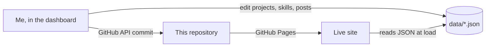

<div align="center">


<a href="https://github.com/Shubhamkeshri433/Shubhamkeshri433.github.io">
  
</a>

<br/>

[](https://shubhamkeshri433.github.io/)
[](https://www.linkedin.com/in/shubhamkeshri433/)
[](mailto:shubhamkeshri.433@gmail.com)


</div>

---

## 👋 About me

I turn raw, messy data into clear decisions. I work mostly with **SQL, Python and Power BI**, and I like projects where the end result is something a non-technical person can read and act on: a dashboard, a ranked list, a clean chart.

|  |  |
|---|---|
| 📍 **Based in** | Delhi, India |
| 🎓 **Education** | BCA, Amity University · CGPA 7.35 · graduating Jul 2027 |
| 💼 **Looking for** | Full-time roles and internships (remote or hybrid) |
| 📫 **Reach me** | [shubhamkeshri.433@gmail.com](mailto:shubhamkeshri.433@gmail.com) · [LinkedIn](https://www.linkedin.com/in/shubhamkeshri433/) |

---

## 🌐 This repository is my portfolio

**👉 [shubhamkeshri433.github.io](https://shubhamkeshri433.github.io/)**

A manga-style personal site. On desktop it is a 3D scroll-through film of my journey (past, present, future). On phones and with reduced motion it becomes a light, fast page with the same content.

**What makes it more than a template**

- 🗂️ **Content lives in JSON.** Projects, skills, blog posts and page text are plain files in [`data/`](data), so the site never needs a rebuild to change.
- 🛠️ **Owner-only dashboard.** I wrote my own editor (`/dashboard/`) with a visual blog editor (drag photos and videos, crop and compress images, wrap text around them), project and skills managers, history with diffs, and a site-health check.
- 🔒 **Safe by design.** No server and no database. The dashboard saves straight to this repo through the GitHub API using a short-lived, repo-scoped token. Pages use a strict Content Security Policy, a custom Markdown renderer that never uses `innerHTML`, and refuse to load inside other sites' frames.
- 🔎 **SEO-ready.** Sitemap (refreshed automatically when I publish a post), canonical links, structured data and per-post descriptions.
- ⚡ **No build step.** Plain HTML, CSS and ES modules. Three.js is vendored for the 3D scene.



---

## 🚀 Featured projects

| Project | What it does | Stack |
|---|---|---|
| **[AI Resume Ranker](https://github.com/Shubhamkeshri433/AI-Resume-Ranker)** | AI-powered candidate screening that ranks resumes against a job description using NLP and semantic vector similarity. |    |
| **[Customer Shopping Behavior Analysis](https://github.com/Shubhamkeshri433/Customer-Shopping-Behavior-Analysis)** | Retail customer analysis with multi-tier segmentation and Power BI executive dashboards. |    |
| **[Maven Fuzzy Factory Analysis](https://github.com/Shubhamkeshri433/Maven-Fuzzy-Factory-data-analysis-project)** | Website traffic, channel conversion funnels and revenue optimisation for an online store. |   |
| **[US Honey Visualisation Practice](https://github.com/Shubhamkeshri433/US-Honey-Visualisation-Practice)** | Hands-on visualisation practice on US honey production data: trends, rankings and correlations. |    |

More write-ups on the [blog](https://shubhamkeshri433.github.io/blog.html).

---

## 🧰 Skills

**Programming** &nbsp;


**SQL & Databases** &nbsp;


**Data Analytics & BI** &nbsp;


**Tools** &nbsp;


---

## 📂 What's in this repo

```text
├── index.html, blog.html, projects.html, skills.html, connect.html   public pages
├── data/            projects, skills, posts, page text and profile (JSON)
├── dashboard/       owner-only editor (needs a GitHub token to do anything)
├── css/             site theme (manga.css) and dashboard theme (dash.css)
├── js/              site code, safe Markdown renderer, 3D scene, dashboard
├── sitemap.xml      kept up to date by the dashboard
└── ADMIN.md         how the dashboard works and how to keep it safe
```

---

## 🤝 Let's talk

I'm looking for a **data analyst or data science role (or internship)** where I can keep learning and ship work people actually use.

<div align="center">

[](https://www.linkedin.com/in/shubhamkeshri433/)
[](mailto:shubhamkeshri.433@gmail.com)
[](https://shubhamkeshri433.github.io/)


</div>
